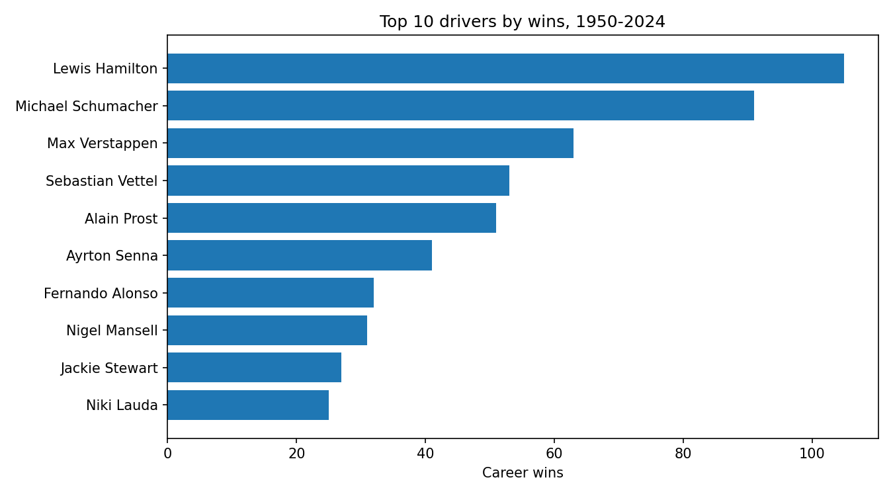

# Formula 1 Data Analysis — 1950 to 2024

> A pandas analysis of 75 years of Formula 1: 26,759 race results, 1,125 races, 861 drivers, 77 circuits. Plus a FastF1 setup for live session data.



## Headline findings (computed from the data in this repo)

- **Most wins:** Lewis Hamilton — **105**, ahead of Michael Schumacher (91) and Max Verstappen (63)
- **Most career points:** Hamilton — **4,820.5**, ahead of Sebastian Vettel (3,098) and Verstappen (2,912.5)
- **Span:** 1950–2024, 54 distinct Grands Prix across 77 circuits

Full tables: `outputs/top_drivers_by_wins.csv`, `outputs/top_drivers_by_points.csv`. Chart: `outputs/races_per_decade.png`.

## Run it

```bash
pip install -r requirements.txt
python src/f1_analysis.py
```

`src/f1_analysis.py` starts from the original FastF1 cache setup and runs the historical analysis: driver wins and points tables plus two charts written to `outputs/`.

## Data

`data/drivers.csv` (861 drivers), `data/races.csv` (1,125 races), `data/results.csv` (26,759 results) — the public Ergast-style F1 dataset.

## Author

**Umer Farooq** — Economic & Climate Risk Analyst · [LinkedIn](https://www.linkedin.com/in/umer-farooq-gojra/) · [GitHub](https://github.com/umerfarooq7424)

## License

MIT — see LICENSE.
